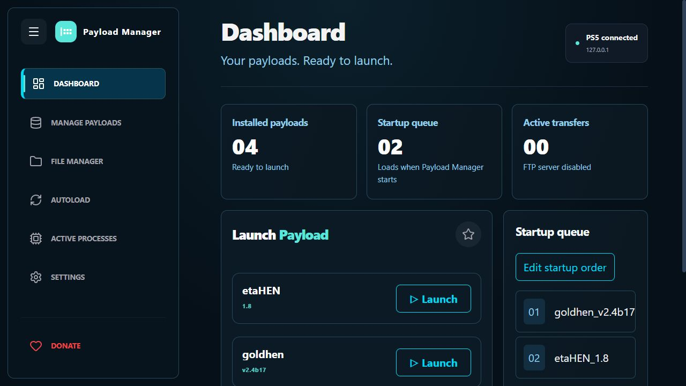
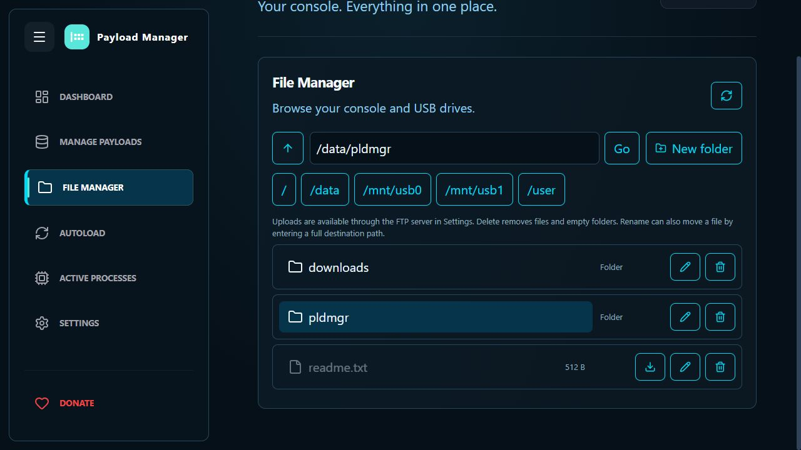
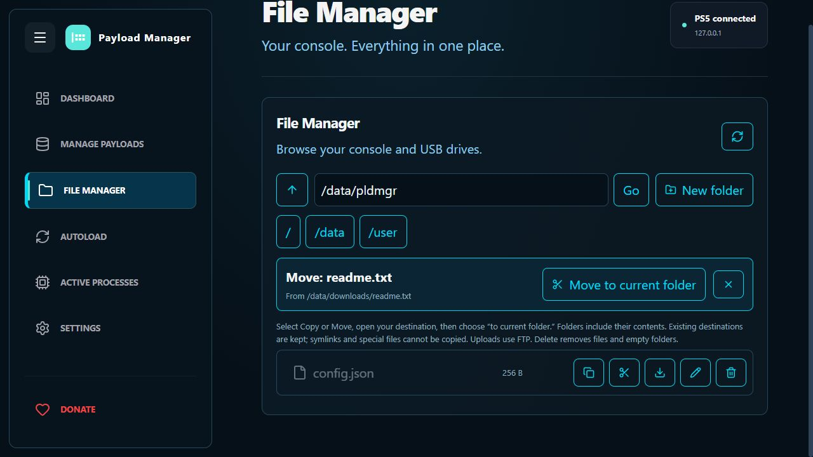
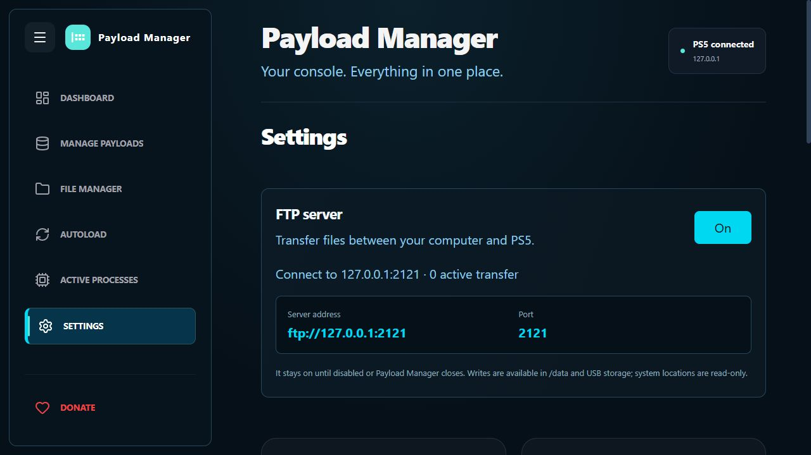

 

<h1 align="center">PS5 Payload Manager</h1>

Payloads, files, and FTP in one place. Customized by TRMOfficial, based on itsPLK Payload Manager.

  

## TRMOfficial AIO update

This fork extends [itsPLK's PS5 Payload Manager](https://github.com/itsPLK/ps5-payload-manager) with a redesigned dashboard, a File Manager, and an optional FTP server. The app remains named **Payload Manager**.

### What changed

- **New dashboard:** dark cyan styling, sidebar navigation, installed-payload count, startup queue, transfer count, console IP, and visible Launch controls.
- **Existing functions retained:** payload launching, favorites, USB imports, repository downloads and sources, autoload order and delays, process controls, logs, app installation, and existing settings.
- **File Manager:** browse console and USB folders, download files, create folders, copy files and folders with their contents, move them within storage or between drives, rename files, and delete files or empty folders. Select Copy or Move, open the destination, and choose **Copy to current folder** or **Move to current folder**. Existing destinations are not overwritten. USB drives appear only while mounted. Writes are supported in /data and USB storage; system locations are read-only. File uploads use FTP.
- **FTP in Settings:** switch the built-in server on or off. When enabled, Settings shows the PS5 IP address and port **2121**, with no username or password fields. FTP starts off each time Payload Manager starts, supports passive transfers, and serves one client at a time.
- **FTP startup fix:** the worker now has an explicit 1 MB thread stack and stores its 64 KB transfer buffer on the heap. The previous compiled worker reserved over 73 KB before accepting a connection, creating a risk of immediate stack overflow. The corrected native worker passes a stack-frame limit of 32 KB. FTP startup is now confirmed working on the PS5.
- **Transfer handling:** stopping FTP closes its connections. Interrupted client transfers are handled without stopping Payload Manager. If another payload uses port 2121, Settings reports the conflict.

### Screenshots

These screenshots show the implemented interface in a local preview with sample data. They are not photographs or captures from a PS5.

**Dashboard**

**File Manager**

**Move to current folder**

**FTP settings — IP and port only**

### Build and testing

The [AIO build and integration tests passed](https://github.com/TRMOfficial23/ps5-payload-manager/actions/runs/38109343126). Tests cover real file operations, FTP upload/download, write restrictions, server stop/restart, an abrupt client disconnect, repeated startup toggles with a small-default-stack harness, nested folder copies, moves between mounted drives, USB visibility, collision protection, and failed-copy cleanup. **Confirmed on a physical PS5 by TRMOfficial:** FTP connects and transfers successfully; switching FTP off closes the connection while Payload Manager stays running. File Manager operations, including deletion and transfers, were tested and confirmed working. v1.11 is the verified working baseline. Other edge cases listed above are covered by automated integration tests.

Download the verified **v1.11 ELF** from [this fork's release](https://github.com/TRMOfficial23/ps5-payload-manager/releases/tag/trm-aio-v1.11). The release includes the same compiled ELF used in the successful PS5 test. The Actions artifact **TRMOfficial-Payload-Manager-5** is also available while retained. Future builds can be started from this fork's build workflow. The upstream releases and autoloaders described below contain the upstream manager; use this fork's compiled ELF for these AIO additions.

---

## Features
- **Web-Based Interface**: A modern dashboard to manage payloads from your PC, phone, or the PS5 itself.
- **Import Payloads**: Easily add new payloads from a USB drive or download them from the cloud repository.
- **Automated Startup**: Set up a list of payloads to load automatically whenever you start the manager.
- **Home Screen Shortcut**: Installs a dedicated "Payload Manager" app icon to your PS5 home screen for quick access.
- **Auto-Close Disc Player**: Optional setting to automatically close the Disc Player on startup (useful for BD-JB users).

## Installation

### Using an Autoloader (Recommended)
It is highly recommended to use **Payload Manager** together with an **Autoloader**:

[Y2JB](https://github.com/itsPLK/ps5-y2jb-autoloader) | [BD-JB](https://github.com/itsPLK/ps5-bdjb-autoloader) | [Lua](https://github.com/itsPLK/ps5-lua-autoloader)

`pldmgr.elf` is already included as the default payload in the latest versions of the Autoloaders linked above.

If you are using an older version and don't want to update the entire autoloader, you can simply:
1. Place `pldmgr.elf` into your `autoload` directory.
2. Add `pldmgr.elf` as the only entry in your `autoload.txt` config file.

### Standalone / Manual Loading
You can also manually load the manager like any other `.elf` file. For this AIO fork, download the verified ELF from [TRMOfficial Releases](https://github.com/TRMOfficial23/ps5-payload-manager/releases/tag/trm-aio-v1.11). Rename it to `pldmgr.elf` if your existing loader expects that name.

## Custom Repositories
You can add third-party payload repositories to the manager. To learn how to create your own repository JSON and host it, see the [Custom Repositories Guide](CUSTOM_REPOSITORIES.md).

## Translations
PS5 Payload Manager supports multiple languages thanks to the community! 
If you'd like to help translate the app into your native language or improve existing translations, please visit our [Crowdin project](https://crowdin.com/project/ps5-payload-manager). 
All translations are managed exclusively through Crowdin.

**Translation Guidelines:**
- Please only submit translations in languages you are fluent in.
- Only translate strings when you know exactly what they mean in the context of the app. If you're unsure, it's much better to leave it untranslated than to guess incorrectly.
- *Pro Tip:* The best way to translate is to have the Payload Manager running on your PS5 or browser so you can navigate the UI and see the exact context of the buttons and descriptions you are translating!

### Supported Languages
| Language | Progress | Translator(s) |
| :--- | :---: | :--- |
| **Arabic** |  | [mohamad.z.k28](https://crowdin.com/profile/mohamad.z.k28), [abdoulacadat](https://crowdin.com/profile/abdoulacadat), [DumDum143](https://crowdin.com/profile/DumDum143), [HoussamLovy](https://crowdin.com/profile/HoussamLovy), [c0ncerta](https://crowdin.com/profile/c0ncerta), [sgs2ofameer](https://crowdin.com/profile/sgs2ofameer) |
| **Chinese Simplified** |  | [owendswang](https://crowdin.com/profile/owendswang), [carlchina](https://crowdin.com/profile/carlchina) |
| **French** |  | [Oblik20](https://crowdin.com/profile/Oblik20), [Chronoss](https://crowdin.com/profile/Chronoss) |
| **German** |  | [stylefile](https://crowdin.com/profile/stylefile), [xEasy4Breezy](https://crowdin.com/profile/xEasy4Breezy), [FENDHOUSE](https://crowdin.com/profile/FENDHOUSE), [baschte](https://crowdin.com/profile/baschte), [mighel88](https://crowdin.com/profile/mighel88) |
| **Italian** |  | [Leon90](https://crowdin.com/profile/Leon90) |
| **Japanese** |  | [Jane101KR](https://crowdin.com/profile/Jane101KR) |
| **Korean** |  | [Jane101KR](https://crowdin.com/profile/Jane101KR), [pop9871517](https://crowdin.com/profile/pop9871517) |
| **Persian** |  | [Epinor](https://crowdin.com/profile/Epinor), [FCGre](https://crowdin.com/profile/FCGre) |
| **Polish** |  | [najdek](https://crowdin.com/profile/najdek) |
| **Portuguese, Brazilian** |  | [matmarson](https://crowdin.com/profile/matmarson), [slipttees](https://crowdin.com/profile/slipttees), [marcusvrb](https://crowdin.com/profile/marcusvrb) |
| **Russian** |  | [Akela-1979](https://crowdin.com/profile/Akela-1979) |
| **Spanish** |  | [Slayver95](https://crowdin.com/profile/Slayver95), [kXmpX](https://crowdin.com/profile/kXmpX), [sagatgs](https://crowdin.com/profile/sagatgs) |
| **Thai** |  | [Modmycon](https://crowdin.com/profile/Modmycon), [hpokemon776](https://crowdin.com/profile/hpokemon776) |
| **Turkish** |  | [Sezar61](https://crowdin.com/profile/Sezar61), [hpokemon776](https://crowdin.com/profile/hpokemon776) |
| **Ukrainian** |  | [Mikeeee](https://crowdin.com/profile/Mikeeee) |

## Credits
- [John Törnblom](https://github.com/john-tornblom) - for the [shell UI installer](https://github.com/ps5-payload-dev/ftpsrv/blob/master/install-ps5.c) and various payloads used as reference.
- [BenNoxXD](https://github.com/BenNoxXD) - for the [Disc Player App termination logic](https://github.com/BenNoxXD/PS5-BDJ-HEN-loader/blob/main/HENloader_C_part/src/kill_disc_player.c).
- [owendswang](https://github.com/owendswang) - for [contributions](https://github.com/itsPLK/ps5-payload-manager/commits/main/?author=owendswang)
- Everyone else contributing to the PS5 homebrew scene.

## Donations
If you'd like to support my work, please check out the [DONATE.md](DONATE.md) file.

## Development
For build instructions and deployment details, see [DEVELOPMENT.md](DEVELOPMENT.md).
